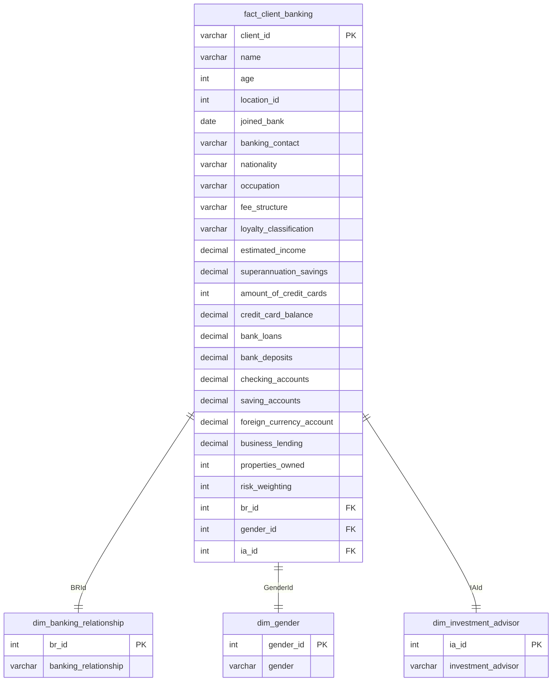

# Credit Risk Analytics & Portfolio Liquidity Optimization

## Executive Summary & Problem Statement

Banks need to understand their customers' loan balances, deposits, and credit card balances to manage their banking portfolios effectively.

This project focuses on analyzing customer banking data using SQL, relational database concepts, and Power BI. The objective is to organize banking data, calculate important financial metrics, and understand patterns in loans and deposits.

The project uses SQL for database creation, data cleaning, table joins, and calculations, along with Power BI to present the results through an interactive dashboard.

---

## Solution Architecture & Data Modeling

The project uses a relational database structure to organize customer information and reduce data duplication. The tables are connected using primary keys and foreign keys.

### Database Schema (Entity Relationship Diagram)

---

## Technical Formulations & KPIs

The following metrics are used to understand customer loans, deposits, and credit exposure.

### 1. Credit Exposure Indicators

- **Total Loan Exposure:** The total amount of loans and business lending provided to customers.

  Total Loan Exposure = Bank Loans + Business Lending

- **Credit Card Balance:** The outstanding amount customers owe on their credit cards.

- **Total Credit Exposure:** The combined value of bank loans, business lending, and credit card balances.

  Total Credit Exposure = Bank Loans + Business Lending + Credit Card Balance

### 2. Liquidity & Solvency Indicators

- **Total Deposit Balance:** The total amount customers hold across checking, savings, and foreign currency accounts.

  Total Deposit Balance = Checking Accounts + Savings Accounts + Foreign Currency Accounts

- **Loan-to-Deposit Ratio (LDR):** This ratio compares the total loan balance with the total deposit balance.

  LDR = (Total Loan Balance / Total Deposit Balance) × 100

  It helps understand how the bank's lending compares with the deposits it holds.

---

## Repository Structure

The project files are organized into the following folders:

- **[`data/`](./data/):** Contains the banking data files.
  - `raw/`: Contains the original CSV files.
- **[`sql/`](./sql/):** Contains SQL scripts.
  - [`schema_ddl.sql`](./sql/schema_ddl.sql): Creates tables and defines primary and foreign keys.
  - [`data_cleaning_transformation.sql`](./sql/data_cleaning_transformation.sql): Contains queries for cleaning and transforming data.
  - [`kpi_metrics_calculations.sql`](./sql/kpi_metrics_calculations.sql): Contains queries to calculate banking metrics.
- **[`notebooks/`](./notebooks/):** Contains the data analysis notebook.
  - [`1_exploratory_data_analysis.ipynb`](./notebooks/1_exploratory_data_analysis.ipynb): Used to explore the data and identify patterns.
- **[`dashboards/`](./dashboards/):** Contains the Power BI dashboard.
  - [`credit_risk_dashboard.pbix`](./dashboards/credit_risk_dashboard.pbix): Displays the main banking metrics and analysis.
- **[`docs/`](./docs/):** Contains the project report and presentation.
  - `images/`: Contains dashboard screenshots.
  - [`banking_project_report.docx`](./docs/banking_project_report.docx): Project report.
  - [`banking_project_presentation.pptx`](./docs/banking_project_presentation.pptx): Project presentation.

---

## Executive Dashboard Interface

The Power BI dashboard presents the main findings from the banking data.

- **Home Page:** Displays key metrics such as total loan exposure, total deposits, and calculated fees.
- **Loan Analysis:** Compares loan balances across customer groups and regions.
- **Deposit Analysis:** Shows how deposits are distributed across checking, savings, and other accounts.

The dashboard helps users compare different customer groups and understand the bank's loan and deposit portfolio.

---

## Strategic Recommendations & Portfolio Insights

Based on the analysis of the banking data, the following observations can help in understanding the bank's portfolio.

### 1. Deposit Analysis

- **Insight:** Comparing checking and savings account balances helps identify where customer deposits are held.
- **Recommendation:** The bank can study customer deposit patterns to understand account usage and identify opportunities to improve its banking services.

### 2. Loan Balance Analysis

- **Insight:** Comparing loan balances across customer income groups helps identify which groups hold a larger share of the bank's loans.
- **Recommendation:** The bank can monitor loan distribution across customer groups to better understand its lending portfolio.

### 3. Regional Analysis

- **Insight:** Comparing loan and deposit balances across regions helps identify differences in banking activity.
- **Recommendation:** The bank can use these comparisons to understand regional trends and make better-informed business decisions.

### 4. Customer and Credit Analysis

- **Insight:** Customer income, loan balances, and credit card balances can be compared to understand differences in customer credit exposure.
- **Recommendation:** The bank can use these metrics to identify customer groups that may require closer review and improve its understanding of credit exposure.
