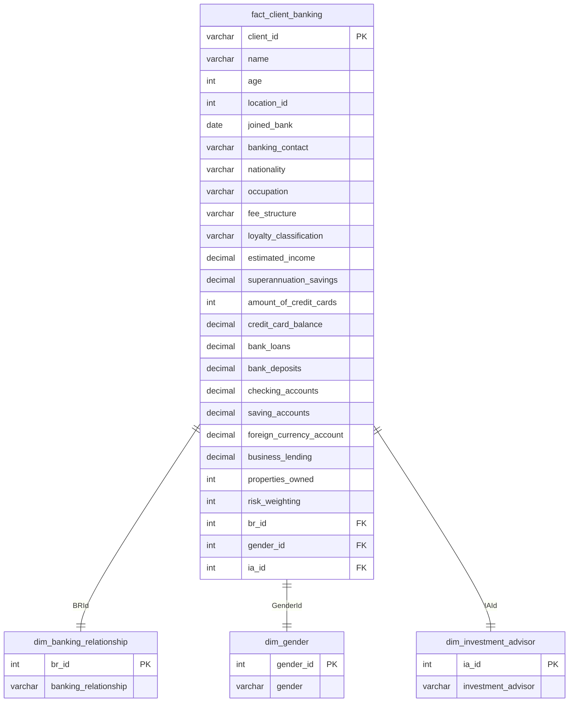

# Credit Risk Analytics & Portfolio Liquidity Optimization

## 📌 Executive Summary & Problem Statement

Financial institutions face significant challenges in accurately assessing customer credit risk while balancing loan growth and minimizing defaults. Existing lending decisions often rely on multiple risk indicators that require effective analysis of customer transaction and financial data. This project aims to develop a data-driven credit risk analytics solution that improves risk assessment, predicts the likelihood of default, and supports informed credit decision-making.

By implementing an end-to-end data pipeline combining **relational database modeling (SQL)**, **statistical profiling (Python)**, and **interactive executive reporting (Power BI)**, this solution provides credit risk officers and portfolio managers with actionable, quantitative insights to optimize risk-adjusted returns.

---

## 🏗️ Solution Architecture & Data Modeling

The project employs a structured star-schema relational model to optimize analytical querying, reduce redundancy, and establish a single source of truth for the loan and deposit books.

### Database Star Schema (Entity Relationship Diagram)

---

## 📈 Technical Formulations & KPIs

To ensure analytical rigor and align with Basel III Capital Accord guidelines, the following quantitative KPIs are calculated across the database and visualization layers:

### 1. Credit Exposure Indicators
*   **Aggregate Debt Exposure ($D_{\text{total}}$)**: Sum of all short-term revolving liabilities and long-term debt commitments.
    $$D_{\text{total}} = L_{\text{bank}} + L_{\text{business}} + B_{\text{cc}}$$
    *Where $L_{\text{bank}}$ is bank loans, $L_{\text{business}}$ is business lending, and $B_{\text{cc}}$ is credit card balance.*

*   **Risk-Weighted Assets (RWA)**: The capital requirements buffer determined by multiplying loan volume by the internal credit risk weight tier.
    $$\text{RWA} = \sum \left( \text{Loan}_i \times \text{Risk Weighting Factor}_i \right)$$

### 2. Liquidity & Solvency Indicators
*   **Total Deposit Liquidity ($S_{\text{total}}$)**: Cumulative customer cash reserves held across checking, savings, term, and foreign currency accounts.
    $$S_{\text{total}} = D_{\text{bank}} + A_{\text{saving}} + A_{\text{checking}} + A_{\text{fx}}$$

*   **Loan-to-Deposit Ratio (LDR)**: Standard systemic liquidity metric. An LDR of $>95\%$ indicates a highly leveraged deposit base, while an LDR of $<75\%$ represents underutilized liquidity.
    $$\text{LDR} = \frac{D_{\text{total}}}{S_{\text{total}}}$$

---

## 📂 Repository Structure

The project files have been organized into a professional production-ready structure:

*   📂 **[`data/`](./data/)**: Houses the relational schemas.
    *   📂 `raw/`: Raw CSV files containing banking relationships, clients database, and advisory data.
*   📂 **[`sql/`](./sql/)**: Contains production SQL scripts.
    *   📄 [`schema_ddl.sql`](./sql/schema_ddl.sql): Data Definition Language setting up tables, primary/foreign keys, and performance indexes.
    *   📄 [`data_cleaning_transformation.sql`](./sql/data_cleaning_transformation.sql): Relational views executing data cleaning, date casting, and metric calculations.
    *   📄 [`kpi_metrics_calculations.sql`](./sql/kpi_metrics_calculations.sql): Analytics queries reporting on LDR, leverage ratios, risk weight distributions, and regional exposures.
*   📂 **[`notebooks/`](./notebooks/)**: Data science and exploratory analytics.
    *   📄 [`1_exploratory_data_analysis.ipynb`](./notebooks/1_exploratory_data_analysis.ipynb): Comprehensive Jupyter notebook documenting statistical profiling, bivariate regression analysis, and heatmaps.
*   📂 **[`dashboards/`](./dashboards/)**: Business intelligence files.
    *   📄 [`credit_risk_dashboard.pbix`](./dashboards/credit_risk_dashboard.pbix): Interactive Power BI dashboard.
*   📂 **[`docs/`](./docs/)**: Executive presentations, screenshots, and visual assets.
    *   📂 `images/`: Screen captures showing the dashboard layouts.
    *   📄 [`banking_project_report.docx`](./docs/banking_project_report.docx): Deep-dive document outlining project KPIs.
    *   📄 [`banking_project_presentation.pptx`](./docs/banking_project_presentation.pptx): Project slide deck.

---

## 🖥️ Executive Dashboard Interface

The Power BI dashboard provides an interactive representation of the bank's liquidity and credit profiles:

*   **Home Page**: Overview of key high-level metrics including Total Loan Exposure ($139.9M), Total Deposits ($111.49M), and Total Calculated Fees ($5.17M) across 188 major institutional and high-net-worth clients.
*   **Loan Analysis**: Granular credit tracking showing that European clients hold the highest loan balances, and mid-income earners represent the highest concentration of debt.
*   **Deposit Analysis**: Liquidity breakdown highlighting that checking and savings accounts hold the vast majority of liquid assets.

---

## 💡 Strategic Recommendations & Portfolio Insights

Based on the statistical relationships identified in the Python EDA and the Power BI dashboard, the following strategic risk and capital allocation recommendations are proposed:

### 1. Wealth Management Arbitrage (Capital Reallocation)
*   **Insight**: Python regression and correlation analysis shows an extremely high correlation ($r \approx 0.80$) between basic `Bank Deposits` and low-yield `Saving Accounts`. 
*   **Recommendation**: This indicates a massive volume of stagnant, non-yield-generating cash (over-liquidity). The bank should launch a targeted campaigns led by the 22 Investment Advisors (`dim_investment_advisor`) to migrate these low-margin deposits into fee-generating wealth management assets under management (AUM).

### 2. Credit Leverage Concentration Risk Limit
*   **Insight**: Bivariate segmentation reveals that the "Mid" income bracket ($100K - $300K) holds the highest volume of bank loans, while "High" income earners carry negligible debt.
*   **Recommendation**: To prevent systemic default risk during macroeconomic downturns, the credit risk committee must institute a strict **Credit Leverage Index (CLI) limit of 1.25** for the mid-income tier. This should be combined with dynamic Debt Service Coverage Ratio (DSCR) underwriting for applicants in this category.

### 3. Geographic Credit Hedging and Exposure Diversification
*   **Insight**: European clients represent the highest loan exposure, while Australian/African regions represent a minimal share.
*   **Recommendation**: The bank's risk exposure is highly concentrated in the European geographical market. The credit committee should adjust the internal risk-weighting factors, applying capital charges to European exposures while establishing promotional interest rates to expand institutional business lending in APAC and AMER.

### 4. Collateral Optimization and Basel III Compliance
*   **Insight**: Properties owned show a weak correlation with internal Risk Weightings, indicating that real-estate collateral is not heavily leveraged to offset risk.
*   **Recommendation**: Integrate property appraisals directly into the risk-weight scoring model to calculate LTVs. By aligning high-value collateral with high-risk clients, the bank can safely reduce its risk-weighted asset (RWA) buffer under Basel III, releasing capital to fund high-margin business lending.
